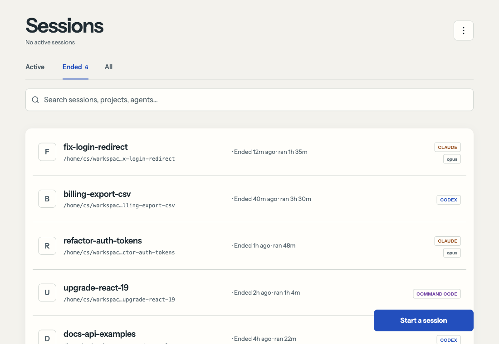
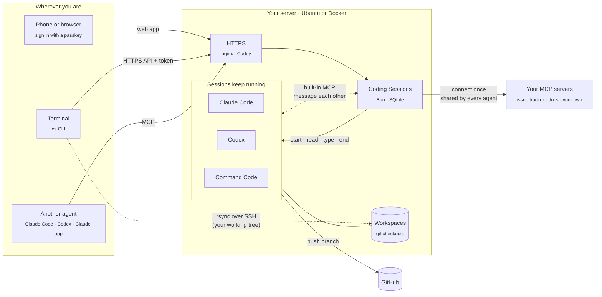
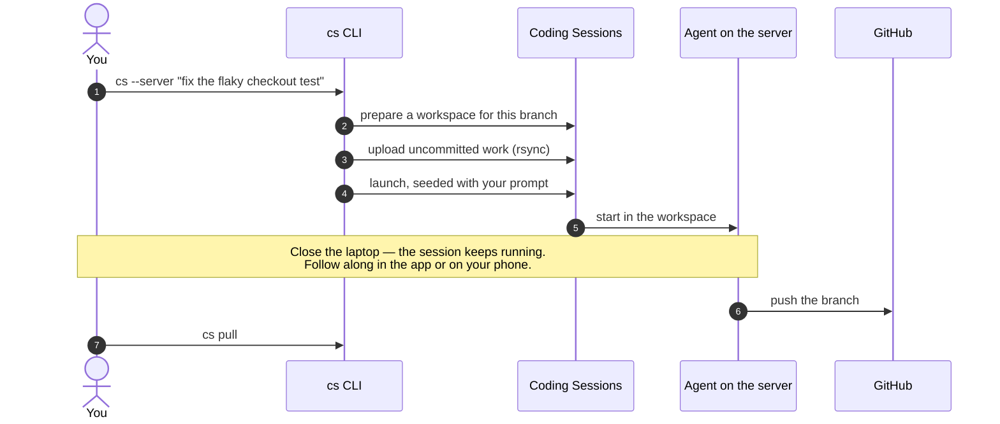

# Coding Sessions

[](LICENSE)
[](https://github.com/MishukAdhikari/coding-sessions/releases)
[](docs/docker.md)
[](#install-on-a-server)
[](https://bun.sh)

*Faster than the fastest. Smoother than the smoothiest.*

### Be lazy. Your coding agents won't be.

Run Claude Code, Codex and Command Code side by side on your own VPS. It feels local. It just
never sleeps. Drive them from your phone, your terminal, or another agent.

- **Close the laptop, keep shipping.** Sessions run on your server, not your machine. Pick them up from your phone, a browser or your terminal.
- **Hand off a branch in one command.** `cs --server "fix the flaky checkout test"` sends your branch, uncommitted work included, to a session on the server.
- **Answer from anywhere.** See which session is waiting on you, read its screen and reply from your phone.
- **Let agents team up.** Ask a Claude session to get a second opinion from a Codex session. Sessions find and message each other over a built-in MCP, with no setup.
- **Connect a tool once.** Sign in to an MCP server one time and every agent shares it.
- **Bring more agents.** One-click presets add Gemini CLI, Kimi Code, Qwen Code and opencode, with the same built-in MCP. They're third-party tools; see [agents](docs/agents.md).
- **Steer it from other agents.** Claude Code, Codex or the Claude app can launch and drive sessions over MCP.
- **Looks after itself.** Docker or Ubuntu install, passkey sign-in, and daily updates that roll back if a release won't start.

Self-hosted and [MIT licensed](LICENSE): your server, your agent accounts, your data.

```bash
git clone https://github.com/MishukAdhikari/coding-sessions.git && cd coding-sessions
echo "CS_HOSTNAME=sessions.example.com" > .env
docker compose --profile https up -d      # then open https://sessions.example.com
```

<picture>
  <source media="(prefers-color-scheme: dark)" srcset="docs/images/sessions-dark.png">
  
</picture>

## How it works



Three ways in, one set of sessions — the sessions can talk to each other, and share the tools you connect:

| | From | Good for |
| --- | --- | --- |
| **Web app** | Phone or browser | Starting, watching and answering sessions; a live terminal on each one |
| **[`cs` CLI](docs/cli.md)** | Your terminal | Handing your current branch to the server, mirroring a session in your terminal |
| **[MCP](docs/mcp.md)** | Claude Code, Codex, the Claude app | Letting one agent launch, message and read others |
| **[Built-in MCP](docs/mcp.md#built-in-session-communicator)** | Every session, automatically | Agents finding each other and trading messages — "ask the Codex session to review this" — with no setup or tokens |

**Connect an MCP server once, use it from every agent.** Add a remote MCP server under
**Settings › External MCP connectors** — sign in with OAuth or paste a token one time —
and Claude Code, Codex and Command Code sessions all share that one connection. You
choose which tools each agent may use; nothing is granted until you tick it.
[External MCP connectors](docs/connectors.md).

### Hand off a branch from your laptop



### Stays up to date on its own


Turn it on in **Settings → App updates**. Docker installs update by pulling the new image.
[More on updates](#automatic-app-updates).

## Get started

| Your server | Do this |
| --- | --- |
| Ubuntu or Debian VPS | [Install on a server](#install-on-a-server): one guided command that sets up HTTPS, agents and the browser |
| Anything with Docker | [Docker](#docker) — one `docker compose up`, automatic HTTPS with Caddy |
| Your laptop, to hack on it | [Local development](docs/local-dev.md) |

> **Preview.** See [validation coverage and remaining checks](deploy/VALIDATION.md) before relying on it for important work.

## Trust model

This is a tool for **one trusted operator per Unix account and instance**, not a multi-tenant SaaS. Browser and MCP access can start programs with that account's permissions. Sessions under the same account can access its workspaces and credentials; project boundaries are not security boundaries.

The Ubuntu installer creates a dedicated non-root account without sudo access. New installations retain provider trust/approval prompts and filter inherited environment variables. These controls reduce exposure but do not isolate hostile workloads. Use a dedicated machine or VM for work you do not trust. Read [Security](docs/security.md) before exposing an instance.

## Third-party software and services

Coding Sessions is the glue. The coding itself is done by other companies' tools, and you sign in to them yourself.

**Agents and where your work goes.** Each agent talks straight to its own vendor, under your account and that vendor's terms. Prompts, the code it reads and its output go to that vendor. Coding Sessions doesn't proxy or store that traffic.

| Agent | Vendor |
|---|---|
| Claude Code | Anthropic |
| Codex | OpenAI |
| Command Code | Command Code |
| Gemini CLI (preset) | Google |
| Kimi Code (preset) | Moonshot AI |
| Qwen Code (preset) | Alibaba (Qwen) |
| opencode (preset) | opencode |

Install only the agents you want; none is required. Details for the presets are in [docs/agents.md](docs/agents.md).

**Software it runs on.** These are open-source projects under their own licenses:
- [Bun](https://bun.sh) runs the app; Node.js and npm install the npm-based agents.
- [ttyd](https://github.com/tsl0922/ttyd) serves the web terminal, and GNU screen keeps sessions alive. git, the GitHub CLI (`gh`), rsync and OpenSSH handle repositories and workspaces.
- JavaScript libraries: SimpleWebAuthn (passkeys), jose, ipaddr.js and Playwright.
- Optional, only if you turn them on:
  - [Caddy](https://caddyserver.com) for HTTPS, from the server installer or in Docker. The manual installer can set up nginx with certbot instead. Both get certificates from Let's Encrypt.
  - Playwright with Chromium for the claude.ai browser, which signs in to claude.ai to manage chats.

**Connections the app makes itself:**
- GitHub, for repositories you pick, for `gh` and for app updates.
- The npm registry and claude.ai's installer, when you install or update agents.
- The MCP servers you add as connectors, with their sign-in servers.
- Let's Encrypt, if you use the HTTPS proxy.
- claude.ai, if you enable the claude.ai browser.

There is no telemetry or analytics, and the web app loads no scripts or fonts from other sites.

## Install on a server

On Ubuntu (22.04, 24.04, 26.04) or Debian (12, 13), with a domain pointing at the server and ports 80 and 443 open:

```bash
curl -fsSLO https://github.com/MishukAdhikari/coding-sessions/releases/latest/download/install.sh
curl -fsSLO https://github.com/MishukAdhikari/coding-sessions/releases/latest/download/install.sh.sha256
sha256sum -c install.sh.sha256 && sudo bash install.sh
```

The installer asks for:

1. the domain;
2. an email for the HTTPS certificate;
3. which coding agents to install, if any;
4. whether to install the browser for claude.ai;
5. whether to update agents daily;
6. on small servers, whether to add swap.

It checks DNS and ports, shows its plan, and asks before changing anything. It then sets up HTTPS with Caddy, the runtimes, your agents, the browser, server limits and the update timers. It ends with a **one-time sign-in link**.

You can also ask an AI agent in this repository to "install Coding Sessions on my server". Its install skill asks you the same questions before running anything. Every option, what setup changes and troubleshooting are in [docs/install.md](docs/install.md).

Want to choose every path yourself, or read all of the source first? See [Manual install](deploy/README.md).

## Docker

Prefer containers? The official image runs anywhere Docker does, with automatic HTTPS:

```bash
echo "CS_HOSTNAME=sessions.example.com" > .env
docker compose --profile https up -d
docker compose exec app cat /home/cs/data/bootstrap-password
```

Open your domain, sign in with that password and add a passkey. [Running with Docker](docs/docker.md) covers installing agents, updates and settings.

## After installing

1. **Sign in.** Open the one-time link and add a passkey. The link works once and expires after 30 minutes. For a new one, run `sudo coding-sessions setup-link` on the server.
2. **Add agents.** **Settings → Agent authentication** lists every supported agent, with an **Install** button and its sign-in. Signing in to an agent applies to the whole server. Agents and presets are described in [docs/agents.md](docs/agents.md).
3. **Start a session.** Pick a repository and an agent. If Codex stops at **Folder trust required**, open the terminal and review the folder yourself; the app never accepts trust for you.
4. **Optional: work from your own terminal.** Install the [`cs` command-line client](docs/cli.md) and run `cs server add personal https://sessions.example.com`. It signs in through your browser, with no token to copy. Then:
   - `cs --server "<prompt>"` hands your current branch to a session on the server;
   - `cs install gemini kimi` installs agents;
   - `cs mcp add` connects Claude Code or Codex to the server.

   For [several servers](docs/cli.md#several-servers), give each one a name and pick it with `--server=<name>`.
5. **Optional: connect Claude or Codex.** Open **Connect Claude or Codex** in the app and approve only connections you started yourself. [MCP setup](docs/mcp.md) covers OAuth and proxies. To let agents use tools from other MCP servers you choose, see [external MCP connectors](docs/connectors.md).

On the server, the `coding-sessions` command handles the rest:

```text
sudo coding-sessions doctor              check everything, with fixes
sudo coding-sessions status              URL, versions, services, updates
sudo coding-sessions agents install gemini kimi
sudo coding-sessions update [--agents]   update the app (and agents)
sudo coding-sessions setup               repair, or change your choices
sudo coding-sessions uninstall           remove; --purge deletes data too
```

## Configuration and secrets

Use [.env.example](.env.example) for non-secret configuration. Keep secrets out of the checkout.

| Material | Storage |
|---|---|
| Origin, port, paths, permission mode | Instance `.env` / `EnvironmentFile`; no secret values |
| Initial admin password and token encryption key | Root-private files delivered through systemd `LoadCredential` |
| Admin password | Password hash in SQLite; bootstrap file remains sensitive |
| Custom-command and app-managed Command Code API tokens | AES-256-GCM ciphertext in SQLite when the encryption key is configured |
| Native provider and GitHub logins | Provider-managed files in the service account's home |
| Browser session, CLI bearer, and inbound OAuth code/access/refresh tokens (apps connecting to Coding Sessions) | Hashes in SQLite |
| External MCP connector credentials (bearer tokens; outbound OAuth access/refresh tokens and client secrets) | AES-256-GCM ciphertext in SQLite; refused without the encryption key |
| Secrets for sessions (Settings › Secrets) and secret-manager credentials (Bitwarden, Infisical, Vault/OpenBao) | AES-256-GCM ciphertext in SQLite; refused without the encryption key; delivered to every managed session as environment variables |

### Server settings in the app

Six settings can also be changed from **Settings → Server settings**, without editing the server's configuration or restarting:

| Setting | Server configuration | Values |
|---|---|---|
| Default repository | `CS_DEFAULT_REPO` | `owner/repository`, or empty |
| GitHub owners | `CS_GITHUB_OWNERS` | Comma-separated accounts and organizations |
| Claude.ai sign-in email | `CAI_EMAIL` | An email address, or empty |
| Terminal mouse | `CS_TERM_MOUSE` | `on` or `off` |
| App update channel | `CS_APP_UPDATE_CHANNEL` | `releases` or `main`; installer-managed servers only |
| Agent permissions | `CS_AGENT_PERMISSIONS` | `standard` or `unrestricted` |

The server's configuration is the starting value. A value changed in Settings is stored in the app's database and wins until you choose **Reset to server default**. Changing agent permissions or the update channel asks for your passkey (or the admin password when no passkey is registered). A new permission mode applies to sessions started afterwards; running sessions keep the mode they started with. Origin, ports, proxy trust, cookies and secret files stay in the server's configuration only.

Legacy instances without an encryption key retain plaintext app-token compatibility. Adding a key encrypts subsequent token writes; it does not automatically rewrite old rows or backups. The application decrypts tokens for provider delivery, so encryption at rest does not hide them from the running account. Details: [secret handling and recovery](docs/security.md).

## Updates and removal

### Automatic app updates

Turn on **Settings → App updates → Update automatically every 24 hours**. Once a day, between 04:00 and 05:00 UTC, the server checks GitHub for the newest release tag (`vX.Y.Z`). If it is newer than what is running, the server:

1. builds it as a new release next to the current one, using the committed lockfile with install scripts disabled;
2. switches to it and restarts the web service — running agent sessions keep running;
3. checks that it answers within 20 seconds, and if not, switches back to the previous release.

It is off by default, and the same panel shows the last result and the running version. The toggle only writes a flag in the instance's own data folder. The update itself is done by a root timer that the installer adds, so the web service never gets admin rights. A release that changes the system units is not installed automatically; the panel says so, and you run setup again for it.

To follow the `main` branch instead of tagged releases, choose it in **Settings → Server settings → App update channel**, or set `CS_APP_UPDATE_CHANNEL=main` in `/etc/coding-sessions/NAME.env`. The choice in Settings wins. The app writes it to `data/app-update-channel`, which the root updater reads only as the word `releases` or `main`. To update from your own fork or a mirror, set `CS_APP_UPDATE_REPO` in the same file to its https URL or to a root-owned local path.

This works on every server set up with the installer: Ubuntu 22.04, 24.04 or 26.04, or Debian 12 or 13, on amd64 or arm64, with outbound HTTPS to `github.com`. Any VPS, cloud VM, bare-metal or home server running those releases works. Docker updates by pulling a new image instead ([Docker](docs/docker.md)). Hand-built installs show **Not set up** in Settings.

### Updating by hand

```bash
sudo coding-sessions update            # the app, right away
sudo coding-sessions update --agents   # the app and the installed agents
```

Agents update daily at 00:00 UTC if you said yes to daily updates during setup. To change that, run `sudo coding-sessions setup` again. Running sessions keep their agent version; new sessions use the updated one. Neither timer updates the operating system.

### Removing it

`sudo coding-sessions uninstall` stops the app and every agent session, and removes the app and its HTTPS site. Your data stays in `/var/lib/coding-sessions/NAME` and `/etc/coding-sessions`. Add `--purge` to delete the data, agent logins and workspaces too. Both ask you to type the instance name first.

Manual installs update, roll back and retire as described in [deploy/README.md](deploy/README.md).

## Development and security reports

See [local development](docs/local-dev.md) for Bun setup, HTTPS, tests, and Linux-specific verification. Report vulnerabilities privately following [SECURITY.md](SECURITY.md).
