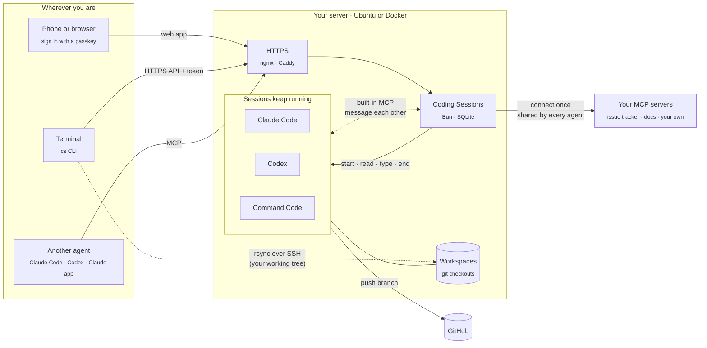
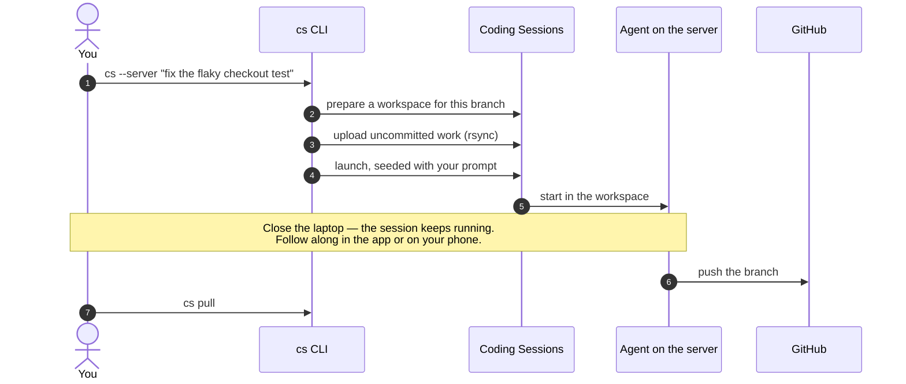
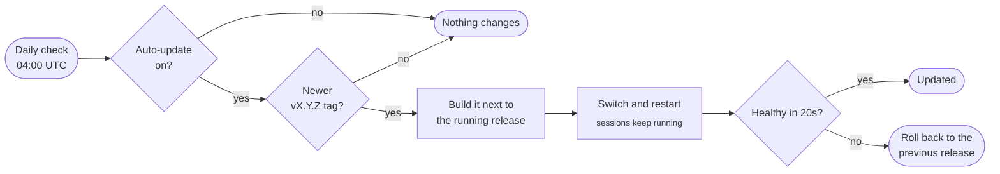

# Coding Sessions

[](LICENSE)
[](https://github.com/MishukAdhikari/coding-sessions/releases)
[](docs/docker.md)
[](#ubuntu-quickstart)
[](https://bun.sh)

*Faster than the fastest. Smoother than the smoothiest.*

### Be lazy. Your coding agents won't be.

Run Claude Code, Codex and Command Code side by side on your own VPS. It feels local. It just
never sleeps. Drive them from your phone, your terminal, or another agent.

- **Close the laptop, keep shipping.** Sessions run on your server, not your machine. Pick them up from your phone, a browser or your terminal.
- **Hand off a branch in one command.** `cs --server "fix the flaky checkout test"` sends your branch, uncommitted work included, to a session on the server.
- **Answer from anywhere.** See which session is waiting on you, read its screen and reply from your phone.
- **Let agents team up.** Ask a Claude session to get a second opinion from a Codex session. Sessions find and message each other over a built-in MCP, with no setup.
- **Connect a tool once.** Sign in to an MCP server one time and every agent shares it.
- **Bring more agents.** One-click presets add Gemini CLI, Kimi Code, Qwen Code and opencode, with the same built-in MCP. They're third-party tools; see [agents](docs/agents.md).
- **Steer it from other agents.** Claude Code, Codex or the Claude app can launch and drive sessions over MCP.
- **Looks after itself.** Docker or Ubuntu install, passkey sign-in, and daily updates that roll back if a release won't start.

Self-hosted and [MIT licensed](LICENSE): your server, your agent accounts, your data.

```bash
git clone https://github.com/MishukAdhikari/coding-sessions.git && cd coding-sessions
echo "CS_HOSTNAME=sessions.example.com" > .env
docker compose --profile https up -d      # then open https://sessions.example.com
```

<picture>
  <source media="(prefers-color-scheme: dark)" srcset="docs/images/sessions-dark.png">
  
</picture>

## How it works



Three ways in, one set of sessions — the sessions can talk to each other, and share the tools you connect:

| | From | Good for |
| --- | --- | --- |
| **Web app** | Phone or browser | Starting, watching and answering sessions; a live terminal on each one |
| **[`cs` CLI](docs/cli.md)** | Your terminal | Handing your current branch to the server, mirroring a session in your terminal |
| **[MCP](docs/mcp.md)** | Claude Code, Codex, the Claude app | Letting one agent launch, message and read others |
| **[Built-in MCP](docs/mcp.md#built-in-session-communicator)** | Every session, automatically | Agents finding each other and trading messages — "ask the Codex session to review this" — with no setup or tokens |

**Connect an MCP server once, use it from every agent.** Add a remote MCP server under
**Settings › External MCP connectors** — sign in with OAuth or paste a token one time —
and Claude Code, Codex and Command Code sessions all share that one connection. You
choose which tools each agent may use; nothing is granted until you tick it.
[External MCP connectors](docs/connectors.md).

### Hand off a branch from your laptop



### Stays up to date on its own



Turn it on in **Settings → App updates**. Docker installs update by pulling the new image.
[More on updates](#automatic-app-updates).

## Get started

| Your server | Do this |
| --- | --- |
| Ubuntu 24.04 / 26.04 VPS | [Ubuntu quickstart](#ubuntu-quickstart) — dedicated account, systemd, optional nginx |
| Anything with Docker | [Docker](#docker) — one `docker compose up`, automatic HTTPS with Caddy |
| Your laptop, to hack on it | [Local development](docs/local-dev.md) |

> **Preview.** See [validation coverage and remaining checks](deploy/VALIDATION.md) before relying on it for important work.

## Trust model

This is a tool for **one trusted operator per Unix account and instance**, not a multi-tenant SaaS. Browser and MCP access can start programs with that account's permissions. Sessions under the same account can access its workspaces and credentials; project boundaries are not security boundaries.

The Ubuntu installer creates a dedicated non-root account without sudo access. New installations retain provider trust/approval prompts and filter inherited environment variables. These controls reduce exposure but do not isolate hostile workloads. Use a dedicated machine or VM for work you do not trust. Read [Security](docs/security.md) before exposing an instance.

## Ubuntu quickstart

Prerequisites:

- Ubuntu Server 24.04 or 26.04, amd64 or arm64, with systemd and administrative access.
- A hostname whose DNS points to the server, and HTTPS termination with WebSocket support.
- A reviewed checkout and a reviewed Linux Bun binary. Alternatively, supply an exact Bun release and its independently verified archive SHA-256.
- Provider CLIs and accounts, installed separately under the dedicated service account; the helper requires Node.js 22+ and npm for Codex and Command Code.

Clone and review the source, then substitute your hostname and Bun path:

```bash
git clone https://github.com/MishukAdhikari/coding-sessions.git
cd coding-sessions
sudo ./deploy/install-ubuntu \
  --instance personal \
  --origin https://sessions.example.com \
  --port 9121 \
  --bun /absolute/path/to/reviewed/bun \
  --install-nginx
sudo certbot --nginx -d sessions.example.com
```

`--check` validates inputs and reports target paths without installing. `--no-start` stages installation without starting services. `--install-nginx` is optional if you already manage a reverse proxy. Do not expose the application port directly; complete HTTPS before browser use. See [Installer operations](deploy/README.md) for all flags, provider installation, and host compatibility checks.

For `personal`, the service is `coding-sessions@personal`, the account is `cs-personal`, and its home is `/var/lib/coding-sessions/personal`. Configuration lives in `/etc/coding-sessions/personal.env`; application releases live under `/opt/coding-sessions/personal`.

## Docker

Prefer containers? The official image runs anywhere Docker does, with automatic HTTPS:

```bash
echo "CS_HOSTNAME=sessions.example.com" > .env
docker compose --profile https up -d
docker compose exec app cat /home/cs/data/bootstrap-password
```

See [Running with Docker](docs/docker.md) for installing agents, updates and settings.

## First sign-in

Retrieve the installer-generated administrator password in your private SSH terminal:

```bash
sudo cat /etc/coding-sessions/credentials/personal/admin-password
```

Do not paste it into issues, chats, or logs. Open your HTTPS origin, sign in, and register a passkey. The password file initializes the password hash; editing it later is not an automatic password-reset mechanism.

Install and authenticate agents as `cs-personal`, never as root. Once Node.js 22+ and npm are available, the optional helper installs selected CLIs:

```bash
sudo -u cs-personal -H /opt/coding-sessions/personal/current/deploy/install-provider-clis codex claude command-code
```

The same helper installs the agent presets (`gemini kimi qwen opencode`); see [docs/agents.md](docs/agents.md).

Use **Agent authentication** in the app for supported sign-in/account actions. Account changes apply to the whole instance. Existing logins may have an unknown login date, and providers do not all expose email addresses.

Fresh Codex workspaces may pause at folder trust. The app shows **Folder trust required** while startup is pending; open the terminal to review the folder yourself. It does not accept trust on your behalf or report readiness before the managed hook arrives.

Managed Codex sessions require Codex 0.166.0 or newer and additionally need the root-owned hook policy installed with `--codex-hooks`. Existing Codex policies are not silently replaced. Review the installer guide before enabling this host-wide policy.

To work from your own terminal, install the [`cs` command-line client](docs/cli.md): `cs --server "<prompt>"` hands your current branch to a server session, and `cs mcp add` connects Claude Code or Codex in one step.

For MCP, open **Connect Claude or Codex** and follow the connection instructions. Approve only connections you initiated. See [MCP setup](docs/mcp.md) for OAuth and reverse-proxy details. To let agents use tools from remote MCP servers you choose, see [external MCP connectors](docs/connectors.md).

## Configuration and secrets

Use [.env.example](.env.example) for non-secret configuration. Keep secrets out of the checkout.

| Material | Storage |
|---|---|
| Origin, port, paths, permission mode | Instance `.env` / `EnvironmentFile`; no secret values |
| Initial admin password and token encryption key | Root-private files delivered through systemd `LoadCredential` |
| Admin password | Password hash in SQLite; bootstrap file remains sensitive |
| Custom-command and app-managed Command Code API tokens | AES-256-GCM ciphertext in SQLite when the encryption key is configured |
| Native provider and GitHub logins | Provider-managed files in the service account's home |
| Browser session, CLI bearer, and inbound OAuth code/access/refresh tokens (apps connecting to Coding Sessions) | Hashes in SQLite |
| External MCP connector credentials (bearer tokens; outbound OAuth access/refresh tokens and client secrets) | AES-256-GCM ciphertext in SQLite; refused without the encryption key |

### Server settings in the app

Six settings can also be changed from **Settings → Server settings**, without editing the server's configuration or restarting:

| Setting | Server configuration | Values |
|---|---|---|
| Default repository | `CS_DEFAULT_REPO` | `owner/repository`, or empty |
| GitHub owners | `CS_GITHUB_OWNERS` | Comma-separated accounts and organizations |
| Claude.ai sign-in email | `CAI_EMAIL` | An email address, or empty |
| Terminal mouse | `CS_TERM_MOUSE` | `on` or `off` |
| App update channel | `CS_APP_UPDATE_CHANNEL` | `releases` or `main`; installer-managed servers only |
| Agent permissions | `CS_AGENT_PERMISSIONS` | `standard` or `unrestricted` |

The server's configuration is the starting value. A value changed in Settings is stored in the app's database and wins until you choose **Reset to server default**. Changing agent permissions or the update channel asks for your passkey (or the admin password when no passkey is registered). A new permission mode applies to sessions started afterwards; running sessions keep the mode they started with. Origin, ports, proxy trust, cookies and secret files stay in the server's configuration only.

Legacy instances without an encryption key retain plaintext app-token compatibility. Adding a key encrypts subsequent token writes; it does not automatically rewrite old rows or backups. The application decrypts tokens for provider delivery, so encryption at rest does not hide them from the running account. Details: [secret handling and recovery](docs/security.md).

## Updates and removal

### Automatic app updates

Turn on **Settings → App updates → Update automatically every 24 hours**. Once a day, between 04:00 and 05:00 UTC, the server checks GitHub for the newest release tag (`vX.Y.Z`). If it is newer than what is running, the server:

1. builds it as a new release next to the current one, using the committed lockfile with install scripts disabled;
2. switches to it and restarts the web service — running agent sessions keep running;
3. checks that it answers within 20 seconds, and if not, switches back to the previous release.

The last result and the running version show in the same panel. It is off by default. The toggle only writes a flag in the instance's own data folder; the update itself is done by a root timer (`coding-sessions-app-update@NAME.timer`) that the installer adds, so the web service never gets admin rights. A release that changes the system units is not installed automatically — the panel says so, and you rerun the installer for it.

To follow the `main` branch instead of tagged releases, choose it in **Settings → Server settings → App update channel**, or set `CS_APP_UPDATE_CHANNEL=main` in `/etc/coding-sessions/NAME.env`. The choice in Settings wins; the app writes it to `data/app-update-channel`, which the root updater reads only as the word `releases` or `main`. To update from your own fork or a mirror, set `CS_APP_UPDATE_REPO` there to its https URL or to a root-owned local path. To update right away as an administrator:

```bash
sudo /opt/coding-sessions/personal/current/deploy/update-app personal --now
```

### Which servers support it

Automatic app updates work on any server installed with `deploy/install-ubuntu`:

- **Operating system:** Ubuntu Server 24.04 or 26.04 with systemd.
- **CPU:** amd64 (x86-64) or arm64.
- **Network:** outbound HTTPS to `github.com`.
- **Providers:** any VPS or cloud VM that runs those Ubuntu images — for example Hetzner Cloud, DigitalOcean, Vultr, Linode/Akamai, OVHcloud, AWS EC2 or Lightsail, Google Compute Engine, Azure VMs and Oracle Cloud (including Ampere arm64). Bare-metal and home servers on the same Ubuntu releases work too.

Not supported by the in-app switch: other distributions, containers (Docker updates by pulling a new image — see [Docker](docs/docker.md)), LXC without systemd, shared hosting, and hand-built installs that were not made with the installer — those show **Not set up** in Settings. Rerun the installer on an existing installer-managed instance to add the updater.

### Manual app updates

Review a new checkout and rerun the installer for the same instance and settings, omitting `--install-nginx` if its site already exists. Keep backups and the previous release until health checks pass. The installer preserves managed configuration and credentials and refuses to take over unmanaged paths; a changed shared unit requires separate review.

Provider CLI updates are separate. Opt in with `--daily-updates`, or manage the daily timer as an administrator:

```bash
sudo systemctl enable --now coding-sessions-update@personal.timer
sudo systemctl start coding-sessions-update@personal.service
sudo systemctl disable --now coding-sessions-update@personal.timer
```

The default schedule is daily at 00:00 UTC. The UI can show update status, but new isolated installs leave privileged timer control to administrators. This timer does not update the application (see above) or the operating system.

To retire an instance, first end its sessions and back up its state and credentials. Disable its update timers (`coding-sessions-update@NAME.timer` and `coding-sessions-app-update@NAME.timer`) and application service, then remove its reverse-proxy route. There is no automatic destructive uninstall: review and remove only that instance's release, state, credential, configuration, and ownership-marker paths, and its `cs-NAME` account. Shared template units may serve other instances. Stopping the web service alone does not guarantee detached agents have exited.

**Existing deployments:** do not point this installer at a personal service account or an unmanaged production directory. Inventory paths, credentials, approval settings, detached sessions, and backup recovery first. Explicit `unrestricted` permission mode and `inherit` environment mode exist for deliberate legacy compatibility; they are not the new-install defaults.

## Development and security reports

See [local development](docs/local-dev.md) for Bun setup, HTTPS, tests, and Linux-specific verification. Report vulnerabilities privately following [SECURITY.md](SECURITY.md).
