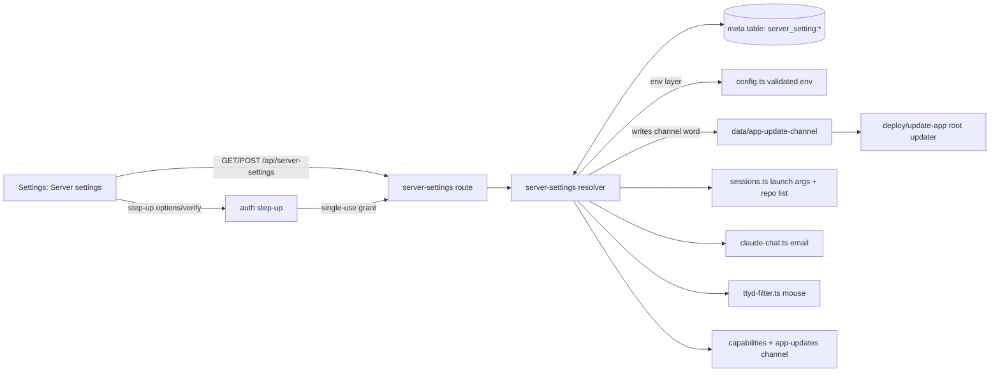

# feat: Server settings section

## Goal Capsule

**Objective.** Six behaviors that only the server's environment controls today become editable in Settings, take effect without a restart, and keep the environment value as the starting default.

**Done when.** The default repo, allowed GitHub owners, claude.ai sign-in email, agent permission mode, terminal mouse and app update channel can each be changed and reset from Settings; the permission change needs a fresh passkey (or the admin password when no passkey exists) and affects only sessions started afterwards; the root updater honors the channel chosen in Settings; tests and docs cover it.

---

## Summary

A "Server settings" section in Settings edits six values that today come only from environment variables. Each value resolves as *stored override, else environment, else built-in default*, read where it is used rather than once at startup. The agent permission mode is guarded by a step-up passkey check.

---

## Problem Frame

`server/config.ts` reads `CS_DEFAULT_REPO`, `CS_GITHUB_OWNERS` and `CS_AGENT_PERMISSIONS` once at startup into `config`. `CAI_EMAIL` comes from `process.env` in `server/claude-chat.ts`, `CS_TERM_MOUSE` from the environment in `server/ttyd-filter.ts`, and `CS_APP_UPDATE_CHANNEL` from the environment in `server/app-updates.ts` and from the root env file in `deploy/update-app`. Changing any of them means editing the server config and restarting. Settings already shows several (the default repo, the permission mode in launch hints, the update channel) without being able to change them.

---

## Requirements

- R1. Settings has a Server settings section that edits: default repo, allowed GitHub owners, claude.ai sign-in email, agent permission mode, terminal mouse, app update channel.
- R2. Each value resolves stored override → environment → built-in default. Each has "Reset to server default", which deletes the override.
- R3. Changes apply without a restart. Changing owners invalidates the cached repo list.
- R4. Changing the permission mode requires a fresh step-up verification, applies only to sessions started afterwards, and Settings says so.
- R5. The claude.ai email used by browser sign-in is the effective value, validated as today.
- R6. The root updater reads the channel from a fixed-word file the app writes in its data directory; without `CS_APP_UPDATE_STATUS` the channel control is shown as unavailable.
- R7. Validation matches `server/config.ts`; mutations require a browser session and same origin; responses carry no secrets.
- R8. README / docs describe the section and the precedence rule.

---

## Key Technical Decisions

- **Precedence: stored override wins over environment.** (session-settled: user-directed — chosen over "the config file locks the value" and "Settings only": the env value stays the starting default for fresh and existing installs, and a Settings change wins; reset restores the env value.)
- **Permission change safeguard: step-up check, new sessions only.** (session-settled: user-directed — chosen over a plain confirm dialog and over restarting running sessions: a stolen browser session must not be able to disable agent prompts, and running work must not be interrupted.)
- **Scope: all six settings.** (session-settled: user-directed — chosen over a subset.)
- **One resolver module owns the six settings.** A new `server/server-settings.ts` defines each setting (key, env name, validator, default), and exposes `effective(name)`, `describe()` (value, source: `settings` | `server` | `default`, env value) and `set/reset`. It reuses the existing `meta` table (`getMeta`/`setMeta`) under a `server_setting:` key prefix, so no schema change is needed. A `deleteMeta` helper is added for reset.
- **Read at the point of use.** `config.repository`, `config.repoOwners` and `config.unrestrictedAgents` are replaced by calls to the resolver. `config.ts` keeps validating the environment values at startup, so a bad env value still fails fast, and the resolver uses those validated values as its "server" layer.
- **Running sessions keep their launch mode for free.** Permission flags are baked into each agent's command line at launch (`server/sessions.ts`), so per-launch resolution already means "new sessions only". No session bookkeeping is needed.
- **Step-up uses the existing WebAuthn challenge store with a new purpose.** `server/auth.ts` gains a `"step-up"` challenge purpose with options/verify functions. Verification yields a short-lived, single-use step-up grant tied to the browser session (e.g. 2 minutes) that the permission mutation consumes. When no usable passkey exists, the step-up accepts the admin password instead (same rate limits as login).
- **Channel handoff to the root updater mirrors the auto-update flag.** The app writes `data/app-update-channel` containing exactly `releases` or `main`. `deploy/update-app` reads it only as a regular, non-symlink file and only those two words; anything else is ignored and the env file value applies. This keeps the root process from trusting arbitrary content from the instance home.
- **Terminal mouse becomes a live read of the resolver.** `ttyd-filter.ts` already evaluates per frame, so it switches from the environment to the resolver's effective value (cheap in-memory cache invalidated on change).
- **New section, not a reuse of "Server & history".** That existing section holds actions (CLI updates, end all); the new "Server settings" section holds editable values, placed above it.

---

## High-Level Technical Design

Resolution order for every setting: stored override → environment (validated at startup) → built-in default.

---

## Implementation Units

### U1. Settings resolver and storage

**Goal:** One place that defines, validates, stores and resolves the six settings.
**Requirements:** R2, R3, R7
**Dependencies:** none
**Files:** `server/server-settings.ts` (new), `server/db.ts` (add `deleteMeta`), `server/server-settings.test.ts` (new)
**Approach:** Definitions table per setting: env name, validator identical to `server/config.ts` (repo `owner/name`, owners list, email shape, `standard|unrestricted`, `on|off`, `releases|main`), built-in default. `effective`, `describe`, `set`, `reset`; small in-memory cache invalidated on set/reset. Channel `set`/`reset` also writes/removes `data/app-update-channel`.
**Patterns to follow:** `server/app-updates.ts` (pure functions with injectable paths), `readCsSetting` in `server/environment.ts`.
**Test scenarios:**
- No override, env set → effective is env value, source `server`.
- No override, no env → built-in default, source `default`.
- Override set → wins over env; `describe` reports source `settings` and still shows the env value.
- Reset → override removed, falls back to env.
- Invalid values (bad repo, owner with spaces, malformed email, unknown mode/channel) are rejected with the same messages config.ts uses; nothing stored.
- Channel set writes exactly `releases`/`main` to the data-dir file; reset removes it.
**Verification:** resolver tests pass; no behavior change until consumers switch (U2).

### U2. Consumers read the resolver

**Goal:** Every use of the six values reads the effective value at the point of use.
**Requirements:** R3, R5, R6
**Dependencies:** U1
**Files:** `server/sessions.ts`, `server/index.ts`, `server/claude-chat.ts`, `server/ttyd-filter.ts`, `server/app-updates.ts`, `server/config.ts`, tests: `server/config.test.ts`, `server/app-updates.test.ts`, existing sessions/ttyd/claude-chat tests as touched
**Approach:** Replace `config.unrestrictedAgents` (all launch-argument and trust sites), `config.repository`, `config.repoOwners` with resolver calls. Owner changes clear the repo list cache. Capabilities response reports effective repository and permission mode. `claude-chat` uses the effective email. `ttyd-filter` mouse uses the resolver. App-updates `channel` reports the effective value.
**Test scenarios:**
- With an override of `unrestricted`, a newly built Claude/Codex/Command Code launch command includes the skip-permission flags; with `standard` it does not.
- Changing owners then listing repos queries the new owners (cache bypassed).
- Capabilities returns the overridden default repo.
- Browser sign-in start uses the stored email; invalid stored email cannot exist (validated at set).
- Mouse `off` override strips mouse sequences in the filter.
**Verification:** full `bun test` green; a live local run shows a launch built with the new mode without restart.

### U3. Step-up verification

**Goal:** A fresh passkey (or admin password when no passkey exists) is required to change the permission mode.
**Requirements:** R4, R7
**Dependencies:** none (can run alongside U1)
**Files:** `server/auth.ts`, `server/index.ts` (step-up routes), `server/auth-step-up.test.ts` (new)
**Approach:** Add `"step-up"` challenge purpose with options/verify. Successful verification issues a single-use grant bound to the current browser session token hash, expiring after ~2 minutes. Password fallback only when `hasPasskey()` is false. Rate-limit like login. Bearer/CLI tokens can never obtain a grant.
**Test scenarios:**
- Login challenge cannot be used for step-up and vice versa.
- Grant is single-use and expires.
- Grant from session A is rejected for session B.
- Password fallback refused when a passkey exists; accepted (with correct password) when none exists.
- Repeated failures hit the rate limit.
**Verification:** tests pass; manual run shows the browser prompting for the passkey.

### U4. Server settings API

**Goal:** Read and change the settings over HTTP safely.
**Requirements:** R1, R2, R4, R7
**Dependencies:** U1, U3
**Files:** `server/server-settings-route.ts` (new), `server/index.ts`, `server/server-settings-route.test.ts` (new)
**Approach:** `GET /api/server-settings` returns each setting's effective value, source, env value and availability (channel unavailable without `CS_APP_UPDATE_STATUS`). `POST` sets or resets one setting; permission-mode changes require and consume a step-up grant. Browser session + same origin required for POST, mirroring `server/cli-updates-route.ts`. No secrets in responses.
**Test scenarios:**
- Unauthenticated → 401; cross-origin POST → 403; bearer/CLI token POST → refused.
- Valid set → 200 and GET reflects it with source `settings`; reset → source `server`.
- Invalid value → 422 with config.ts message.
- Permission change without grant → 403; with grant → 200; grant reused → 403.
- Channel set on a host without updater status → refused as unavailable.
**Verification:** route tests pass.

### U5. Settings UI

**Goal:** A Server settings section that shows and edits the six values.
**Requirements:** R1, R2, R4
**Dependencies:** U4
**Files:** `public/index.html`, `public/app.js`, `public/app.css`, `public/connection-status.js` (if a status row is added), `server/connection-status.test.js` (if touched)
**Approach:** New section above "Server & history". Each row shows the current value and where it comes from ("Set here" / "Server default"), an editor, and "Reset to server default" when overridden. Permission mode row explains that running sessions keep their mode and triggers the step-up prompt before saving. Channel row is disabled with a reason when unavailable. Refreshes capabilities after changes so launch hints and the default repo update immediately.
**Test expectation:** UI is exercised in the live local run (U7); existing JS syntax checks must pass.
**Verification:** in a browser, each setting can be changed and reset; the permission change prompts for the passkey.

### U6. Root updater reads the channel file

**Goal:** Installer-managed hosts honor the channel chosen in Settings.
**Requirements:** R6
**Dependencies:** U1
**Files:** `deploy/update-app`, `deploy/tests/test_installer.py`
**Approach:** After reading the env file channel, if `$instance_home/data/app-update-channel` is a regular, non-symlink file whose content is exactly `releases` or `main`, it overrides the env value. Anything else is ignored.
**Test scenarios:**
- Helper/mode test: file with `main` → channel main; `releases` → releases; garbage, symlink, or missing → env value.
**Verification:** installer tests pass; `bash -n deploy/update-app`.

### U7. Docs and live verification

**Goal:** Document the section and prove it works end to end.
**Requirements:** R8 and all
**Dependencies:** U1–U6
**Files:** `README.md` (Configuration section), `docs/docker.md` (settings table note), `.env.example` (comment that these are starting defaults)
**Approach:** Explain the precedence rule and which settings moved. Run the app locally with a temp `CS_DATA_DIR`, exercise each setting through the API and the UI, including reset and the permission step-up.
**Test expectation:** none -- documentation; verification is the live run.
**Verification:** live run evidence recorded in the PR.

---

## Scope Boundaries

- Out: hardcoded limits (5 GB disk guard, `~/workspaces`, history of 200, 04:00 update timer).
- Out: security-critical environment (ORIGIN, RP_ID, PORT, CS_LISTEN_HOST, proxy trust, key and password files, COOKIE_SECURE, MCP_REDIRECT_HOSTS).
- Out: restarting running sessions when the permission mode changes.

### Deferred to Follow-Up Work

- README transparency section on third-party components and services (separate change).

---

## Risks & Dependencies

- **Permission escalation via a stolen session.** Mitigated by the step-up grant bound to the session and consumed once; CLI/bearer tokens cannot change it.
- **Root updater trusting app-written data.** Mitigated by accepting only a regular file with one of two fixed words.
- **Behavior drift between env validation and Settings validation.** Mitigated by reusing the same validators in U1 and testing the messages.

---

## Verification Contract

- `bun test` passes with new tests for resolver, step-up, route and consumers.
- `python3 -m unittest discover -s deploy/tests` passes, including the channel file cases.
- No new type errors relative to `main`.
- Live local run: each setting changed and reset via API and UI; a launch command reflects the new permission mode without restart; step-up prompt appears.

## Definition of Done

All units implemented; Verification Contract met; docs updated; no "xcloud" mentions; commits and PR carry no Claude co-author or "Generated with Claude Code" lines.
