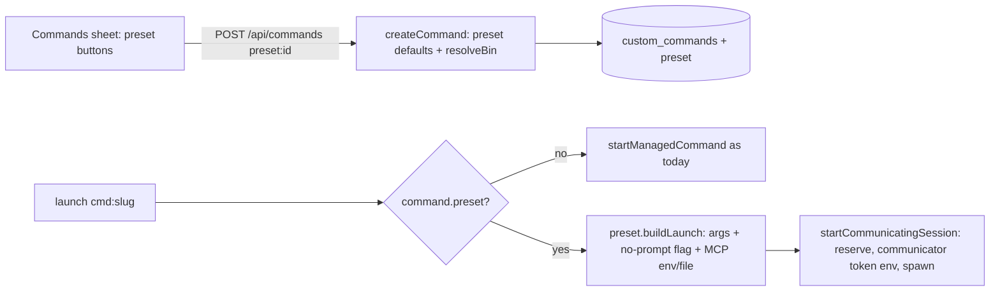

# feat: Agent presets for Gemini CLI, Kimi Code, Qwen Code and opencode

## Goal Capsule

Make four more third-party CLI coding agents one click away. Each is installed with its official method, registered from Settings → Commands with a preset that fills in the right binary, arguments and key variable, and launched through the existing Commands path. Where the agent supports it, the app's own MCP server is wired in, and the server's permission mode is honored. Per-agent turn state, exact resume and sign-in screens are out of scope.

---

## Problem Frame

Today Coding Sessions has first-class support for Claude Code, Codex and Command Code. Any other agent can be registered by hand as a Command (`server/commands.ts`), but the operator must know the binary, flags and key variable. Commands also launch without the communicator MCP server (`startManagedCommand` in `server/sessions.ts` bypasses `startCommunicatingSession`) and ignore the permission mode. The user asked for Kimi, Google's agent "and more popular" ones, choosing presets over full built-in integration.

## Settled Decisions (from the request)

- **Depth:** presets on the Commands path in one PR (user-directed). Rejected: full built-in support for two agents, or for all four. No turn state, exact resume or sign-in screen per agent here.
- **Agent set:** Gemini CLI, Kimi, Qwen Code, opencode (user-directed). Rejected: a subset.

## Conflicts Found with the Request (reported to the caller)

- **Kimi:** `MoonshotAI/kimi-cli` is archived ("Existing installations… will stop working"). The preset targets its official replacement, **Kimi Code CLI** (`@moonshot-ai/kimi-code`, binary `kimi`).
- **R3 for Kimi Code and Gemini CLI:** neither offers a per-launch MCP mechanism usable by an unprivileged account (Gemini refuses system settings files whose folder root doesn't own; Kimi Code has only user/project `mcp.json`). After the user required MCP for every preset ("all the features must support it's mcp"), both get an app-owned entry in the agent's **user-level** config, the same pattern already used for Command Code (`installCommandCodeCommunicator`): ownership marker, operator entries never overwritten, nothing written into the repository. Outside a managed launch the bridge reports itself unavailable.
- **Kimi Code ignores shell API-key variables**, so its preset carries no token variable; the operator signs in with `kimi login` in the web terminal.
- **Gemini CLI** now serves Gemini Code Assist Standard/Enterprise and API-key users only; free and Google AI Pro/Ultra users moved to Antigravity CLI (2026-06-18). The docs state this; the preset is still useful with `GEMINI_API_KEY`.

---

## Requirements

- **R1.** Settings → Commands offers presets for the four agents. Picking one registers it in one step with label, binary, arguments and (where the agent reads one) a key variable. Custom commands keep working unchanged.
- **R2.** `deploy/install-provider-clis` installs each preset agent with its official method; `deploy/update-coding-clis` updates installed ones; `server/cli-updates.ts` reports their versions. The Docker image uses the same script.
- **R3.** Every preset session gets the communicator MCP server (and the connector gateway when available) in the agent's own format. User requirement: all presets must support MCP.
- **R4.** When the permission mode is unrestricted at launch, the preset adds the agent's documented no-prompt option; standard adds nothing. Read once per launch.
- **R5.** Docs list the presets, install commands, key variables, what works and what doesn't, and say plainly these are third-party tools with their own accounts and terms.
- **R6.** Tests cover presets, invocation building, MCP injection per agent and installer entries.

---

## Verified Agent Facts (official sources, read 2026-11-04)

| | Gemini CLI | Kimi Code | Qwen Code | opencode |
|---|---|---|---|---|
| Binary | `gemini` | `kimi` | `qwen` | `opencode` |
| npm package (Node) | `@google/gemini-cli` (≥20) | `@moonshot-ai/kimi-code` (≥22.19) | `@qwen-code/qwen-code` (≥22) | `opencode-ai` (v1) or `@opencode/cli` (v2) |
| No-prompt option | `--approval-mode=yolo` | `--auto` ("Never Ask") | `--approval-mode yolo` | v1: `--auto`; v2: unverified |
| MCP mechanism (tested locally with a stub server) | `~/.gemini/settings.json` `mcpServers` entry; env must be referenced explicitly (`$VAR`) — inherited token vars are stripped; connects only in a trusted workspace | `~/.kimi-code/mcp.json` `mcpServers` entry; inherits the launch env | `--mcp-config '<json>'` per launch; inherits the launch env | `OPENCODE_CONFIG_CONTENT` with `{env:VAR}` references |
| Key variable | `GEMINI_API_KEY` | none read from env (`kimi login`) | `OPENAI_API_KEY` | none fixed (`opencode auth login`) |
| License | Apache-2.0 | MIT | Apache-2.0 | MIT |

Sources: google-gemini/gemini-cli (README, docs/cli/cli-reference.md, docs/reference/configuration.md, docs/tools/mcp-server.md, docs/cli/trusted-folders.md); MoonshotAI/kimi-code (README, docs/en/reference/kimi-command.md, customization/mcp.md, configuration/env-vars.md); QwenLM/qwen-code (README, docs/users/configuration/settings.md, features/mcp.md); anomalyco/opencode (README), opencode.ai/docs/{cli,config,mcp-servers,permissions}, opencode.ai/v2/docs; npm registry entries for each package.

---

## Key Technical Decisions

- **KTD1. Presets are code, not data.** A single module defines each preset: id, label, binary, default args, key variable, npm package, no-prompt args and an MCP injector. Rationale: the flags and MCP formats are version-sensitive facts that need tests; operators can't usefully edit them.
- **KTD2. A registered preset is a Command with a `preset` column.** `custom_commands` gains a nullable `preset` text column (added with the existing `addColumn` pattern). The launch path branches on it; rows without a preset behave exactly as today.
- **KTD3. Preset launches go through `startCommunicatingSession`.** That gives them the launch reservation, the communicator token in the environment and cleanup on failure. The command's own token still travels via the screen environment, never argv. `startCommunicatingSession` takes the provider as data for command providers (`cmd:<slug>`) and accepts an MCP-configuration override instead of the built-in `configure` switch.
- **KTD4. MCP per agent, tokens only in the environment.** Qwen: `--mcp-config` inline JSON. opencode: `OPENCODE_CONFIG_CONTENT` with `{env:…}` references. Gemini and Kimi: an app-owned entry reconciled into the agent's user-level config, by generalizing `installCommandCodeCommunicator`'s reconcile and atomic write (O_NOFOLLOW read, ownership marker, operator entries never overwritten). Gemini's entry lists `CS_*` variables as `$VAR` references because Gemini strips inherited token variables. Gemini's system-settings variable was rejected: it requires a root-owned folder.
- **KTD5. opencode installs v1 (`opencode-ai`, verified 1.19.5: `--auto`, `--prompt`, `OPENCODE_CONFIG_CONTENT`).** v2's flags are undocumented.
- **KTD6. Install through npm into `~/.local`**, like Codex and Command Code. That gives one path for the installer, updater and Docker, and no `curl | bash`. The Node 22 check already in the script covers every package except Kimi Code, which needs 22.19, so its check is per package.
- **KTD7. The version list shows built-ins always and presets only when installed.** A missing optional agent is not a failure.

---

## High-Level Technical Design

---

## Implementation Units

### U1. Preset definitions and invocation building

**Goal:** One module that defines the four presets and builds each launch: argv, extra environment and MCP configuration.
**Requirements:** R1, R3, R4, R6
**Dependencies:** none
**Files:** `server/agent-presets.ts` (new), `server/agent-presets.test.ts` (new), `server/communicator-config.ts` (export the entry builders if needed)
**Approach:**
- Each preset has: `id` (`gemini`, `kimi`, `qwen`, `opencode`), label, bin, default args, envVar or null, npm package, minimum Node version, no-prompt args, and an `mcp(paths, dataDir)` function. That function returns the environment variables to add and, for Gemini and Qwen, the settings file content to write.
- The communicator entry reuses `entry()` and `gatewayEntry()` from `server/communicator-config.ts`; connectors follow `connectors.available()` exactly as for the built-ins.
- `buildPresetLaunch(preset, {unrestricted, connectors, dataDir})` returns argv tail and env; pure apart from writing the settings file.
**Execution note:** Before finalizing flags, install each CLI into a temporary npm prefix locally and confirm with `--help` and `--version`: Gemini/Qwen `--approval-mode`, Kimi `--auto`, opencode `--auto`, and that `OPENCODE_CONFIG_CONTENT` and the system-settings variables exist. Record any mismatch and adjust; do not ship an unverified flag.
**Patterns to follow:** `buildCommandCodeInvocation` in `server/command-code.ts`, `providerCommunicatorArgs` in `server/communicator-config.ts`.
**Test scenarios:**
- Each preset's standard launch has no no-prompt flag. In unrestricted mode the documented flag appears exactly once.
- Gemini and Qwen produce a settings file containing only `mcpServers.coding_sessions_communicator` with the communicator command, args and env references, and no token value. The env adds the right `*_SYSTEM_SETTINGS_PATH` pointing to that file, and the file mode is 0600.
- opencode produces `OPENCODE_CONFIG_CONTENT` JSON with `mcp.coding_sessions_communicator` `{type:"local", command:[bun, bridge], environment}`, and no file.
- Kimi produces no MCP env or file.
- With connectors available, the gateway entry is added for Gemini, Qwen and opencode; without them it is absent.
- Unknown preset ids are rejected.
**Verification:** Unit tests pass. The locally installed CLIs accept the built argv (`--help` smoke).

### U2. Register Commands from presets

**Goal:** `POST /api/commands` accepts `{preset}` and stores a Command with the preset's defaults; `GET /api/commands/presets` lists presets with install status.
**Requirements:** R1, R6
**Dependencies:** U1
**Files:** `server/db-schema.ts`, `server/commands.ts`, `server/index.ts`, `server/commands.test.ts`
**Approach:**
- Add the nullable `preset` column. `createCommand` with a known preset fills label, bin, args and envVar from the preset; the operator may override the label. The binary is still resolved with `resolveBin`, and a missing binary returns an error naming the install command.
- `toCommand` exposes `preset`. The presets route returns `{id, label, installed, installCommand, envVar, mcp: boolean, notes}`.
**Patterns to follow:** the existing `/api/commands*` routes and `validateDraft`.
**Test scenarios:**
- Registering a preset whose binary is on PATH stores bin, args, envVar and preset.
- A missing binary gives an error that includes `install-provider-clis <id>`.
- A duplicate registration is refused like any duplicate label.
- An unknown preset gives 422.
- An existing row without the column reads `preset: null`, and custom commands are unchanged.
- The presets route reports `installed` correctly when the binary is present or absent.
**Verification:** Tests pass; the API works against a temp data dir.

### U3. Launch presets through the communicating path

**Goal:** Preset Commands launch with MCP and the permission mode; plain Commands are unchanged.
**Requirements:** R3, R4, R6
**Dependencies:** U1, U2
**Files:** `server/sessions.ts`, `server/communicator-launch.test.ts` (or a new `server/preset-launch.test.ts`)
**Approach:**
- In `startManagedCommand`, when `command.preset` is set, read the permission mode once and build the launch with U1. Then call `startCommunicatingSession` with provider `cmd:<slug>`, the MCP override and env = command token env + preset env.
- Widen the `CommunicatingSessionOptions.provider` type and the `configure` signature only as far as needed.
- `providerBin` is unused for presets.
**Patterns to follow:** `startManagedCommandCode`.
**Test scenarios:**
- A preset launch spawns `cd <ws> && exec <bin> <args> [no-prompt]` and its env carries `CS_COMMUNICATOR_TOKEN` plus the preset env. The command token is in the env, not in argv.
- A failed spawn removes the reservation and revokes the communicator token.
- A plain Command still takes the old path, with no communicator env.
- The mode is read once: the stubbed `unrestricted` is called once per launch.
**Verification:** Tests pass. In a local run, a preset launch with a stub binary shows the expected command and environment.

### U4. Install, update and version reporting

**Goal:** The installer and updater know the four agents; versions show in CLI updates.
**Requirements:** R2, R6
**Dependencies:** none (parallel with U1)
**Files:** `deploy/install-provider-clis`, `deploy/update-coding-clis`, `server/cli-updates.ts`, `server/cli-updates.test.ts`, `public/app.js` (version list), `deploy/tests/test_installer.py`
**Approach:**
- Add `gemini|kimi|qwen|opencode` cases that install the npm package into `$HOME/.local`. Check Node per package (22.19 for Kimi Code) and run `--version` after install.
- The updater upgrades each only if its binary exists in `~/.local/bin`.
- `VERSION_COMMANDS` gains the four. The UI lists built-ins, plus presets whose version is not null.
**Test scenarios:**
- The installer usage line and case arms list all seven names, with the exact package names. The updater has a guarded block per agent.
- `cli-updates` returns versions for installed presets and `null` for missing ones, and the existing results for built-ins are unchanged.
- `bash -n` passes for both scripts.
**Verification:** Unit and installer tests pass. Installing one preset locally into a temp HOME works (smoke test).

### U5. Commands sheet presets UI

**Goal:** One-click preset buttons in Settings → Commands.
**Requirements:** R1
**Dependencies:** U2
**Files:** `public/index.html`, `public/app.js`, `public/app.css`, `public/sw.js` (cache bump)
**Approach:**
- Above the custom form, show a row per preset with its name, install state and an "Add" button. When the agent is not installed, show the install command to copy instead.
- Rows for already-registered presets show "Added". The intro copy no longer claims commands get no MCP; it now names what presets add.
**Test expectation:** UI behavior is covered by the browser run in Verification; the server side is tested in U2.
**Verification:** In the browser, adding a preset lists it and the agent picker shows it; a missing binary shows the install hint.

### U6. Docs

**Goal:** Transparent docs for presets.
**Requirements:** R5
**Dependencies:** U1–U5
**Files:** `README.md`, `docs/agents.md` (new), `docs/docker.md`, `deploy/README.md`
**Approach:**
- `docs/agents.md` has a table per agent: install command, key variable or sign-in, MCP yes/no, the no-prompt option used, license and upstream link. It also covers what presets lack (turn state, exact resume, sign-in screen) and a third-party notice: separate vendors, accounts, terms and data handling.
- README agent list and install line link to it.
**Test expectation:** none, docs only.

---

## Scope Boundaries

- No per-agent turn state, resume, sign-in screen, connectors UI changes or `cs mcp add` client support.
- No Antigravity CLI preset (Gemini's free-tier successor). That is a candidate follow-up.

### Deferred to Follow-Up Work
- Full built-in integration for any preset agent (user may request per agent).
- Workspace-cleanup of each agent's per-project state (`~/.gemini/tmp`, `~/.qwen/projects`, `~/.kimi-code/sessions`).

---

## Risks

- **Flag drift:** these CLIs move fast. Mitigation: the implementation-time `--help` verification, and tests pinned to the documented flags.
- **User-level entries for Gemini/Kimi persist outside managed launches:** the bridge reports itself unavailable there, as Command Code's already does; documented.
- **Gemini connects MCP only in trusted folders:** unrestricted mode adds `--skip-trust`; in standard mode Gemini asks to trust the folder.
- **Qwen asks to approve project MCP servers in standard mode.** System-level servers may still prompt. Accepted; the docs note it.

---

## Verification Contract

- `bun test` passes; tsc error count unchanged from main.
- Installer tests pass locally, and on Ubuntu when a test needs GNU tools.
- Local run with a temp `CS_DATA_DIR`:
  - Register at least one preset through the API and the UI, using a real CLI installed into a temp prefix.
  - Launch it, and confirm the spawned command and the MCP environment or file.

## Definition of Done

All units implemented with their test scenarios. Docs updated. Verification Contract met. No mention of xcloud. Commits by Mishuk only, without Claude attribution.
